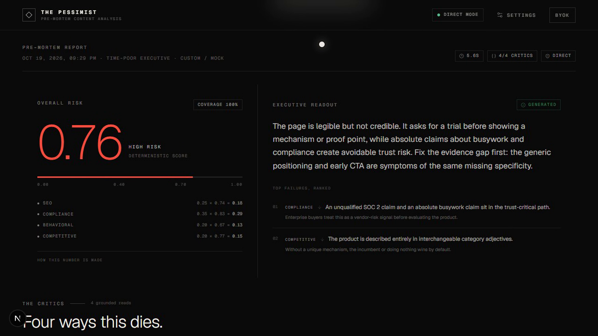

# The Pessimist

**Assume it fails. Then fix it.**

The Pessimist is a pre-mortem content analysis tool. Four independent critic agents try to predict how a draft dies after publication, quote the exact evidence that supports each failure scenario, and propose a repair. A deterministic aggregator turns their rubric scores into a reproducible risk number. A separate, conflict-aware step drafts the prioritized rewrite.

Most content tools ask, "Is this good?" This one asks, "How does it fail?"



- **Live app:**: https://the-pessimist.vercel.app — no server API key required. Use `/demo` for a keyless sample.
- Sample report: `/demo`
- Demo video: [`demo/artifacts/the-pessimist-demo.webm`](./demo/artifacts/the-pessimist-demo.webm) (60s, 1280×720, local mock provider — no API credit used)
- Critic agents: [`agents/`](./agents)
- Changelog: [`CHANGELOG.md`](./CHANGELOG.md)

---

## Contents

- [Why this exists](#why-this-exists)
- [What ships](#what-ships)
- [Architecture](#architecture)
- [BYOK: the two modes](#byok-the-two-modes)
- [Providers](#providers)
- [Choosing a provider](#choosing-a-provider)
- [Critic engine and rubric](#critic-engine-and-rubric)
- [Structured output across providers](#structured-output-across-providers)
- [Grounding check](#grounding-check)
- [Risk score](#risk-score)
- [Fix conflicts and rewrite](#fix-conflicts-and-rewrite)
- [Cost, latency, reliability](#cost-latency-reliability)
- [Local development](#local-development)
- [API](#api)
- [Testing and automation](#testing-and-automation)
- [Security and privacy](#security-and-privacy)
- [Deployment](#deployment)
- [Demo video](#demo-video)
- [Limitations](#limitations)

---

## Why this exists

Content teams use optimistic tools that say "this is good." No one asks "how does this content die?" before publishing. The Pessimist runs four critics with explicit rubrics, rejects hallucinated citations, computes a reproducible score without an LLM, and offers a prioritized rewrite instead of a blind one.

The product is deliberately pessimistic in its method, not in its prose:

1. **Independent critics.** SEO, compliance, behavioral, and competitive. Each has a distinct rubric and its own few-shot anchors.
2. **Evidence or it did not happen.** A critic's quote is checked with `content.includes(quote)`. A hallucinated quote is rejected and retried once, then the critic fails visibly.
3. **Arithmetic, not vibes.** The LLM never computes the risk score.
4. **Conflicts are a feature.** If two critics want opposite changes, the user chooses. The rewrite receives only selected fixes.

## What ships

- Next.js App Router + TypeScript + Tailwind.
- Four critic agents with rubric, two few-shot examples each, Zod validation, one corrective JSON retry, and a deterministic grounding check.
- Provider-agnostic structured output across 8 core presets plus Custom.
- Dual-mode BYOK: stateless proxy and Direct Mode.
- AES-GCM + PBKDF2 key vault in IndexedDB via localForage.
- 24-hour IndexedDB critic cache with cached badges.
- Deterministic risk score with partial-failure coverage.
- LLM summary and top failures in one call.
- Conflict detection and user-selected fixes before rewrite.
- Before/after rewrite diff with source-critic attribution.
- Dark, editorial UI with an empty state, mobile layout, and retryable critic cards.
- Vitest tests, a real-provider critic harness, and a README drift checker.

## Architecture

```
Browser
├── composer + persona
├── AES-GCM key vault (IndexedDB / localForage)
├── 24h critic cache (IndexedDB)
├── orchestrator (4 critics via Promise.allSettled)
│   ├── Mode A: POST /api/analyze {action:"chat"}
│   │            └── stateless provider forward
│   └── Mode B: browser → provider directly
├── deterministic aggregator
├── conflict detector + user resolution
└── rewrite with selected fixes

Server (Mode A only)
└── /api/analyze
    ├── action "chat"    one provider call
    ├── action "ping"    one-token connectivity check
    └── action "analyze" full report for curl/automation
```

The key is decrypted in the browser at request time. In Mode A it travels in the HTTPS request body to the stateless route, is used for that provider call, and is never written to a log, database, cookie, or server-side cache. In Mode B it never reaches our server. Both statements are intentionally narrower than "the key never leaves your browser," because that would be false in Mode A.

## BYOK: the two modes

### Mode A — Stateless proxy (default)

- Key encrypted at rest in IndexedDB with AES-GCM, derived via PBKDF2 (210,000 iterations, SHA-256) from a device-local secret.
- On "Run pre-mortem", the key is decrypted in the browser and sent over HTTPS in the request body.
- The route forwards the request to the selected provider and returns the result.
- The key is used only for that request. It is not logged, persisted, cached, or included in analytics.
- The server does not fall back to another provider or model.

UI notice, shown verbatim in Settings and on the workspace:

> Your key is sent to our stateless proxy for each request. We do not log or store it. If your threat model requires the key to never leave your device, use Direct Mode.

### Mode B — Direct Mode

- The browser calls the provider directly. No proxy.
- Supported by default for Ollama and LM Studio-style Custom endpoints.
- Anthropic is an **advanced opt-in**. It requires `anthropic-dangerous-direct-browser-access: true`; even then, the key is visible in DevTools. It is disabled by default.
- OpenAI and most hosted providers block browser origins with CORS. The app does not pretend otherwise and disables Direct Mode for them.
- Custom endpoints are opt-in because the user is asserting that the endpoint permits browser origins.

### Key vault honesty

The device secret and the AES-GCM ciphertext live in the same IndexedDB origin. This protects against casual disk inspection and raw database dumps. It does **not** protect against XSS, a compromised browser, a malicious extension, or an attacker who can execute same-origin code. It is at-rest encryption, not a hardware vault.

Clearing site data or "Remove all keys & rotate device secret" makes existing ciphertext unrecoverable by design.

## Providers

<!-- provider-table:start -->
| Provider | ID | Base URL | JSON capability | JSON default | Direct Mode | Key |
|---|---|---|---|---|---|---|
| OpenAI | `openai` | `https://api.openai.com/v1` | supported | true | unsupported | required |
| Anthropic | `anthropic` | `https://api.anthropic.com/v1/` | unsupported | false | opt-in | required |
| DeepSeek | `deepseek` | `https://api.deepseek.com/v1` | supported | true | unsupported | required |
| OpenRouter | `openrouter` | `https://openrouter.ai/api/v1` | model-dependent | true | unsupported | required |
| Groq | `groq` | `https://api.groq.com/openai/v1` | supported | true | unsupported | required |
| Zhipu (Z.ai) | `zhipu` | `https://open.bigmodel.cn/api/paas/v4` | supported | true | unsupported | required |
| GitHub Models | `github` | `https://models.github.ai/inference` | model-dependent | true | unsupported | required |
| Ollama | `ollama` | `http://localhost:11434/v1` | model-dependent | true | supported | optional |
| Custom | `custom` | — | model-dependent | false | opt-in | optional |
<!-- provider-table:end -->

The JSON capability is a preset-level statement; the actual toggle is per run. For model-dependent providers, set it according to the model's documentation. If a provider/model rejects `response_format`, turn the toggle off and the wrapper will rely on prompt-level JSON plus Zod validation.

MiniMax, if added later as Custom: overseas `https://api.minimax.io/v1`, China `https://api.minimax.cn/v1`.

### Provider files

Provider metadata lives in [`lib/providers.ts`](./lib/providers.ts). The README table, the capability badges, and the server's validation all read from this model. `npm run check:readme` fails CI if they drift.

## Choosing a provider

### Recommended default: GLM 5.3 Flash

- **OpenRouter:** model `z-ai/glm-5.3-flash`, base URL `https://openrouter.ai/api/v1`.
- **Zhipu (Z.ai):** model `glm-5.3-flash`, base URL `https://open.bigmodel.cn/api/paas/v4`.
- Context: 1,048,576 tokens. The app accepts drafts up to 30,000 characters, so context is never the binding constraint.
- OpenRouter's JSON support depends on the routed model; the preset defaults the toggle on. If the routed model rejects `json_object`, switch it off.

### Recommended alternative: DeepSeek

- Provider `DeepSeek`, model `deepseek-chat`, base URL `https://api.deepseek.com/v1`.
- JSON mode is supported. The critic prompts already contain the word "JSON", as DeepSeek expects.
- Fully supported. No code path depends on GLM, OpenRouter, or any single provider.

### Local and privacy-first

- **Ollama:** Direct Mode, `http://localhost:11434/v1`, model e.g. `llama3.2`. JSON support depends on the model. No key.
- **LM Studio:** choose Custom, Direct Mode, base URL `http://localhost:1234/v1`, model from LM Studio. No key.

### Other supported presets

OpenAI, Anthropic (OpenAI-compatible surface), Groq, and GitHub Models. Each has a capability badge next to the provider dropdown before the first run.

## Critic engine and rubric

**Critic files: 4** — [`agents/seo.md`](./agents/seo.md), [`agents/compliance.md`](./agents/compliance.md), [`agents/behavioral.md`](./agents/behavioral.md), [`agents/competitive.md`](./agents/competitive.md). Each has a JSON few-shot file in [`agents/fewshot/`](./agents/fewshot).

All sub-scores are **failure-risk scores, 0–10**: 0 means no meaningful risk, 10 means severe failure risk. This avoids inverting quality scores in the aggregator.

| Critic | Sub-dimensions | Weights | Overall weight |
|---|---|---|---|
| SEO | Search-intent alignment; Title–body coherence; Keyword / topic coverage | 0.4 / 0.3 / 0.3 | 0.25 |
| Compliance | Claim substantiation; Jurisdictional risk; Disclosure adequacy | 0.5 / 0.3 / 0.2 | 0.35 |
| Behavioral | CTA timing vs. persona awareness; Length vs. patience; Cognitive load | 0.4 / 0.3 / 0.3 | 0.20 |
| Competitive | Differentiation; Specificity vs. generic claims; Evidence of uniqueness | 0.4 / 0.3 / 0.3 | 0.20 |

Each critic returns exactly:

```json
{
  "failure_scenario": "string",
  "evidence_quote": "exact substring from input, or null",
  "sub_scores": { "dim1": 7, "dim2": 6, "dim3": 8 },
  "probability": 0.71,
  "suggested_fix": "string"
}
```

The critic's probability is **recomputed** as the weighted average of its sub-scores divided by 10. The model's own `probability` field is retained in the JSON contract as a consistency signal, but the app does not trust it. A divergence larger than 0.08 is logged.

Two few-shot examples per critic — one high-risk, one low-risk — are injected into the system prompt. The tests assert that both examples exist and that every example's quote is a real substring of its example input.

## Structured output across providers

Implemented in [`lib/llm.ts`](./lib/llm.ts):

1. If the provider/model is flagged as supporting JSON mode, send `response_format: { type: "json_object" }`. Otherwise omit it entirely.
2. Parse the assistant message, strip accidental markdown fences, and validate with a critic-specific Zod schema.
3. On parse or schema failure, make **one** corrective call that includes the Zod error, a minimal valid example of the required shape, and the instruction: "Return only valid JSON matching the schema. Do not add prose."
4. If the corrective call also fails, throw a typed `StructuredOutputError` (stage `parse` or `schema`). The orchestrator catches it and renders a failed critic card with "Retry this critic."
5. Never silently fall back to another model or provider. The user's choice is authoritative.
6. Log `provider`, `model`, `json_mode`, `format`, attempts, and latency per call. Never log the key, messages, or content.

Transport retries are separate: 2 retries with exponential backoff (plus jitter, capped at 8s) on 429 and 5xx. 401 and other 4xx are not retried.

## Grounding check

Before a critic result reaches the UI:

```
if (evidence_quote !== null && !content.includes(evidence_quote)) => reject and retry once
```

The retry message says: "Your quote was not found in the input. Either quote an exact substring or return `evidence_quote: null`."

- A second invalid quote fails the critic with stage `grounding`; the hallucinated citation never reaches the UI.
- An explicit `null` after correction is accepted and marked **unverified**. The UI shows that the finding is a hypothesis, not evidence.
- Empty quotes fail schema validation.

## Risk score

The LLM never computes the overall score. [`lib/aggregator.ts`](./lib/aggregator.ts) does:

```
risk_score = Σ(w_critic × p_critic) / Σ(w_critic)

w_compliance = 0.35
w_seo        = 0.25
w_behavioral = 0.20
w_competitive= 0.20

p_critic = weighted average of its 0–10 sub-scores / 10
```

Example: compliance 0.83, SEO 0.74, behavioral 0.67, competitive 0.77 →

```
(0.35×0.83 + 0.25×0.74 + 0.20×0.67 + 0.20×0.77) / 1.00
= 0.7635
```

Bands: red **> 0.70**, amber **0.40–0.70**, green **< 0.40**.

If a critic fails, it is excluded from both numerator and denominator. The report exposes **coverage** (the counted weight divided by total weight) so a 0.90 from two critics cannot be mistaken for a complete analysis. Treating a failure as 0 would understate risk; treating it as 1 would fabricate it.

The summary and the top three failures are one separate LLM call. The score is available even if that call fails.

## Fix conflicts and rewrite

[`lib/conflicts.ts`](./lib/conflicts.ts) classifies each suggested fix by direction (increase/decrease) and topic (claims, length, CTA, evidence, disclosure, tone). If two critics propose opposite directions on the same topic, the UI shows a conflict and requires a choice.

- Conflicting, unchosen fixes are removed from the rewrite input.
- Non-conflicting fixes are all passed, each attributed to its source critic.
- Rewrite output must include the complete rewritten content, a list of `{critic, before, after, rationale}`, and notes.
- The prompt forbids fabricating facts, numbers, testimonials, or proof points. If a fix needs a fact the draft lacks, the editor must flag it in `notes` rather than invent it.
- The diff stacks vertically on mobile and attributes every material change.

Conflict detection is deterministic and intentionally conservative. It is a guardrail, not a semantic proof. The user always sees both options.

## Cost, latency, reliability

- **Parallelism:** four critics via `Promise.allSettled`; one failure does not block others.
- **Timeout:** 30s per LLM call, 120s total pipeline. A single-critic retry has a 35s guard.
- **Transport retry:** 2 retries with exponential backoff and jitter on 429/5xx. Corrective JSON retry is separate and capped at one.
- **Cache:** SHA-256 over `content + persona + critic + provider + model + prompt version`, stored in IndexedDB for 24h. Cached cards show a badge. Only successful results are cached. Cache writes never include API keys.
- **Budget guard:** estimated analysis cost = four critics + one summary. If the estimate exceeds the configurable ceiling, or the model is premium (above $5 / 1M output tokens), a confirmation dialog appears before the first call.
- **Streaming:** the executive summary and rewrite stream through the provider in both modes. The proxy uses SSE; Direct Mode consumes the provider stream directly. Critics remain non-streaming because structured validation, not token cadence, is their contract. A streamed JSON object is still Zod-validated; if it fails, one non-streaming corrective call is made before any result is accepted.
- **No silent fallback:** a provider/model error becomes a visible failed card.

## Local development

Requirements: Node.js 20+ and npm.

```bash
npm install
npm run dev
```

Open `http://localhost:3000`.

1. Go to `/settings`.
2. Pick a provider. The base URL and model auto-fill.
3. Paste a key. It is encrypted before storage.
4. Click **Test connection** (one-token call).
5. Click **Save settings**.
6. Return home, load the sample or paste a draft, and run the pre-mortem.

No `.env` file is required for the app. `.env.example` only lists keys used by the optional CLI critic harness.

```bash
npm run build
npx tsc --noEmit
npm test
npm run check:readme
```

## API

`POST /api/analyze` is a stateless proxy. It never stores the key. `GET` returns a machine-readable capability description.

### Connectivity check

```bash
curl -s http://localhost:3000/api/analyze \
  -H "Content-Type: application/json" \
  -d '{
    "action": "ping",
    "config": {
      "providerId": "openrouter",
      "baseUrl": "https://openrouter.ai/api/v1",
      "model": "z-ai/glm-5.3-flash",
      "apiKey": "YOUR_KEY",
      "supportsJsonMode": true
    }
  }'
```

### Full report from curl

```bash
curl -s http://localhost:3000/api/analyze \
  -H "Content-Type: application/json" \
  -d '{
    "action": "analyze",
    "config": {
      "providerId": "deepseek",
      "baseUrl": "https://api.deepseek.com/v1",
      "model": "deepseek-chat",
      "apiKey": "YOUR_KEY",
      "supportsJsonMode": true
    },
    "input": {
      "content": "Paste at least forty characters of actual content here. The critics need the real words, not a summary.",
      "personaId": "time-poor-executive"
    }
  }'
```

The response is `{ "report": { ... } }`. It includes critic runs, the deterministic risk object, summary, conflicts, and content hash. The server-run `analyze` action intentionally does not cache; the browser uses IndexedDB cache for interactive runs.

### One proxied chat call

```bash
curl -s http://localhost:3000/api/analyze \
  -H "Content-Type: application/json" \
  -d '{
    "action": "chat",
    "request": {
      "providerId": "openai",
      "baseUrl": "https://api.openai.com/v1",
      "model": "gpt-4o-mini",
      "apiKey": "YOUR_KEY",
      "supportsJsonMode": true,
      "messages": [{ "role": "user", "content": "Return {\"ok\":true} as JSON." }],
      "temperature": 0,
      "maxTokens": 40
    }
  }'
```

Set `"stream": true` on `request` to receive `text/event-stream` events: `delta`, `done`, `error`.

Security guards on the route:

- Remote base URLs must be HTTPS.
- Localhost and loopback URLs are rejected server-side. Local models must use Direct Mode in the browser.
- Base URLs with embedded credentials are rejected.
- Request body is validated with Zod; max 12 messages, max 120,000 characters each.
- An in-memory per-IP rate limit (80 requests/minute) is applied. It is best-effort on serverless and not a durable quota.
- API keys and request bodies are not logged by application code.

## Testing and automation

```bash
npm test                 # 30 Vitest tests
npx tsc --noEmit         # zero errors required
npm run lint             # ESLint: zero warnings
npm run check:readme     # README drift guard
npm run test:critics     # real-provider harness (needs keys)
```

### Browser smoke test

With the dev server running, start the deterministic mock provider in another terminal:

```bash
npm run mock:provider
# then, in another terminal:
npm run test:e2e
```

The browser test configures Custom + Direct Mode against the mock, verifies the 0.76 deterministic score, four critic cards, the SEO/compliance conflict, the streamed rewrite, and the 24h cache badges. It also fails on any browser console error. Use `CHROME_PATH` if Chrome is not in its standard Windows location.

Coverage includes:

- Deterministic aggregator formula, boundaries, and partial failure.
- Conflict detection and explicit resolution.
- Provider JSON-mode request shaping, 5xx retry, no retry on 401.
- One corrective JSON retry and typed second failure.
- Grounding retry, rejection after a second hallucinated quote, and null-quote behavior.
- Streaming JSON extraction, validated streamed output, and corrective fallback.
- Critic output schema snapshot and few-shot evidence integrity.
- Orchestrator parallel behavior, summary isolation, and risk reproducibility.

### README checker

[`scripts/check-readme.ts`](./scripts/check-readme.ts) verifies:

- The number of `agents/*.md` critic files matches **Critic files: 4**.
- Every provider in `PROVIDERS` appears in the README table.
- Base URLs match.
- JSON capability and default match the code.
- Direct Mode and key-requirement columns match.
- Every critic id appears in the rubric table.

Run it in CI and before every release:

```bash
npm run check:readme
```

### Critic harness

`scripts/test-critic.ts` runs every critic against three fixtures (short, long, legal-claim-heavy) on two providers: one with JSON mode and one without.

```bash
# Real calls, if keys are available
OPENROUTER_API_KEY=... ANTHROPIC_API_KEY=... npm run test:critics

# Deterministic structural smoke test without network
npm run test:critics:mock
```

Real-provider mode is skipped for a provider when its key is absent. It writes nothing to disk and prints JSON results plus validation/grounding status.

## Security and privacy

- **No server key persistence.** Mode A keys exist only in the request body and provider headers for the lifetime of the call.
- **No request body logging.** Application logs contain provider, model, JSON-mode flag, status, attempts, and latency only.
- **No silent provider fallback.** Prevents accidental data egress to a different vendor.
- **No analytics or third-party scripts.**
- **AES-GCM at rest.** Honest limitation: same-origin device secret, not XSS-proof.
- **Direct Mode is explicit.** Anthropic is opt-in and warns that the key is visible in DevTools.
- **SSRF posture.** Server proxy accepts HTTPS only and rejects loopback, credentials in URL, and non-HTTP(S) by default. Self-hosters can opt into loopback provider calls with `ALLOW_LOCAL_PROVIDER_PROXY=true`; never enable it on a public deployment. It does not claim to solve DNS rebinding; a hardened self-host should add a destination allowlist and egress firewall.
- **Prompt injection posture.** Content is explicitly marked untrusted in system prompts. This reduces, but cannot eliminate, instruction-following risk in an LLM. Critic outputs are schema-validated, grounding-checked, and never executed.
- **No content at rest on the server.** The interactive pipeline runs in the browser. The `analyze` API action is stateless and returns the report to the caller.
- **Rate limit is best-effort.** Serverless instances do not share memory; use a durable edge limiter for public, high-traffic deployments.

## Deployment

### Vercel

1. Push the repository to GitHub.
2. Import it in Vercel.
3. Framework preset: **Next.js**. Build command `npm run build`. No environment variables are required.
4. Deploy.
5. Open `/settings` and add a key, or use `/demo` for a keyless sample.

`app/api/analyze/route.ts` exports `maxDuration = 120`. On Vercel Hobby, function duration is capped lower (typically 60s); use Pro for the full 120s pipeline, or keep drafts short. Critics have a 30s per-call timeout, so most runs finish well under 60s.

`vercel.json` pins the function duration for projects that support it:

```json
{
  "functions": {
    "app/api/analyze/route.ts": {
      "maxDuration": 120
    }
  }
}
```

The app has no database and no Vercel KV requirement. If you configure a provider through Vercel, do not add its key as a server environment variable; the product is BYOK by design.

### Self-hosting

Any Node.js 20+ host works. Run `npm run build` then `npm start`. Terminate TLS at the edge. If you operate the stateless proxy for untrusted users, add a destination allowlist for Custom URLs and a durable rate limiter.

## Demo video

A 60-second walkthrough is checked in at [`demo/artifacts/the-pessimist-demo.webm`](./demo/artifacts/the-pessimist-demo.webm) (1280×720, 60.7s, VP9 WebM). It was recorded against the local deterministic mock provider, so no real API key or credit appears in the recording. The shot list and capture instructions live in [`DEMO_SCRIPT.md`](./DEMO_SCRIPT.md).

The keyless sample at `/demo` is the safest live demo: it shows the deterministic 0.76 score, four grounded critic cards, and a real SEO/compliance conflict without spending API credit.

To reproduce the recording:

```bash
node scripts/mock-provider.mjs
npm run dev
node scripts/record-demo.mjs   # requires Chrome + playwright-core
```

The deterministic mock also powers browser smoke tests:

```bash
node scripts/mock-provider.mjs
npm run test:e2e
```

## Limitations

- The risk score is reproducible, but the underlying critic probabilities are model judgments. They are anchored by rubrics and few-shots, not ground truth.
- Conflict detection is topic/direction heuristics, not a theorem. It errs toward showing a choice.
- The README checker verifies structural consistency, not the truth of provider documentation. Model IDs change; edit the model field.
- The serverless rate limiter is not durable.
- AES-GCM at rest does not defend against XSS or a compromised browser origin.
- Direct Mode depends on provider CORS behavior, which can change without notice.
- LLM-as-judge can still be wrong. The grounding check prevents invented quotes, not wrong interpretations.

---

Built for teams that care about quality before launch. If it fails in the pre-mortem, it has a chance to survive publication.
